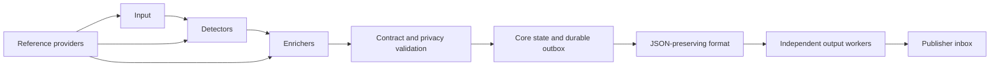

# Plugin architecture, SDK v1

Engine 0.1.0 discovers plugins from installed Python distributions and executes
only configured instances. Six entry-point groups provide extension roles. The
public SDK lives in `wtf_adsb_engine.plugin_api.v1`; built-in integrations use the
same interfaces as separately installed packages.

The core owns configuration validation, plugin selection, observation validation,
identity, revisions, input checkpoints and output progress. Plugins supply
collection, analysis and delivery behavior. Consumers use the JSON boundary
independently of the engine's implementation.



## Roles and installed integrations

Each group is named `wtf_adsb_engine.<role>`. The entry-point name is the stable
plugin ID, and its value resolves to a factory taking a validated options object.

| Role | SDK method | Built-in IDs |
| --- | --- | --- |
| `inputs` | `poll(checkpoint, context) -> InputBatch` | `wtf_adsb.receiver_service`, `wtf_adsb.receiver_json`, `wtf_adsb.json_replay`, `wtf_adsb.journal` |
| `detectors` | `analyze(batch, context)` returns an observation tuple or `DetectionResult` | `wtf_adsb.collection` |
| `enrichers` | `enrich(observation, context) -> EnrichmentResult` | `wtf_adsb.reference_match` |
| `references` | `lookup(context) -> dict` | `wtf_adsb.json_reference` |
| `formats` | `encode(batch, context) -> bytes` | `wtf_adsb.json` |
| `outputs` | `deliver(artifact, manifest, context) -> None` | `wtf_adsb.files` |

`PluginSpec` declares ID, role, version, SDK version, configuration schema and
required/provided capabilities. The registry rejects missing or ambiguous IDs,
unsupported SDK versions and invalid configuration before constructing a plugin.
`plugins` reads entry-point metadata without importing unselected modules.

`Context` carries the configured instance name, its private state directory,
source identity, evaluation time, mode and reference results. It exposes no core
SQLite connection. Plugins can implement `initialize`, `health` and `close` using
the default `Lifecycle` base class. Each instance owns its caches and journal in
its assigned directory. Formatters retain their own instance name and directory
from initialization through encoding; output plugins use separate directories.

The SDK is synchronous and runs trusted code inside the engine process. Python
plugins retain that process's filesystem and network permissions. Configuration
validation, deep copies and wire checks protect accidental interface misuse;
they do not contain malicious code. Generic hard timeouts, subprocess isolation,
an asynchronous task SDK and forced cancellation are not implemented.

## Execution and checkpoint rules

A TOML configuration names pipelines, each with one input, one or more detectors
and optional ordered enrichers. Reference providers run before the pipelines.
The runtime checks declared capability dependencies for inputs, detectors and
enrichers in configuration order. It does not schedule an arbitrary dependency
graph. Each poll, analysis and enrichment call receives the pipeline's mode and
its own copy of reference results. Detectors also receive copies of the input
batch, and enrichers receive copies of the current observation.

`InputBatch` contains records, a proposed checkpoint, an analysis watermark and a
completeness flag. A detector returns `Observation` values with private durable
keys and validated collection-profile data. A `DetectionResult` can also carry
explicit `Retraction` values with private replacement keys for merges and splits.
The core assigns exported event IDs and revisions. It commits accepted
observations, retractions and the checkpoint together.
Plugins must keep retryable state changes idempotent because their own state
files are outside that core transaction.

Extensions already included by a detector require the same reviewed schemas and
payload validation as extensions added by enrichers. A rejected extension keeps
the previous input checkpoint and prevents the observation from entering the outbox.

An enricher returns the exact input evidence digest, a namespace, schema version,
payload and availability state. The runtime rejects a stale digest, an
unavailable result or an unapproved/invalid payload, retains the input checkpoint,
and retries the pipeline on a later poll. Enrichers append approved extensions;
they cannot replace core observations through this SDK. There is no queue for
late asynchronous results. A failed reference provider holds dependent pipelines,
including those whose input requires that reference,
while unrelated pipelines can continue.

The continuous runtime gives each output its own worker, delivery cursor and
persisted artifact bytes. A slow destination can lag while other outputs and
collection advance. Input, detector and enricher hooks remain synchronous, so a
slow hook can delay its pipeline and the next pipeline poll. Destinations receive
the complete validated envelope and must tolerate repeated delivery. An empty
artifact updates manifest health without creating a new evidence batch.

Format plugins currently must return JSON equivalent to the assigned envelope.
They can change JSON byte formatting, but cannot remove findings, alter sequence
numbers or emit CSV/GeoJSON instead. Supporting another format needs an explicit
contract and consumer compatibility decision. The file output publishes an
immutable batch before replacing the manifest that references it.

## Existing analysis as a compatibility plugin

`wtf_adsb.receiver_service` wraps the extracted stateful collector. The supplied
live example collects every 10 seconds in its own worker and projects a full
journal snapshot through `wtf_adsb.collection`, with a configured 60-second
interval between passes. This keeps the detector's observation cadence independent
from export work. Existing analysis,
registry and wind helpers remain internal to that compatibility implementation;
individual rules and provider clients have not all been converted to separate
SDK plugins. Optional provider requests are disabled in the live example.

`wtf_adsb.receiver_json` polls one current receiver snapshot at the configured
pipeline interval. `wtf_adsb.json_replay` reads immutable NDJSON snapshots with a
file hash, byte offset and watermark checkpoint, and rejects changed files or
non-increasing timestamps. Replacement or in-place modification during a poll
also stops replay before its checkpoint advances. The collection detector runs
those reports through its own native journal. `wtf_adsb.journal` provides a
read-only migration bridge
to an existing journal. Every collection instance maintains a private UUID
sidecar so interval corrections preserve exported identity. Witnessed membership
merges and splits produce durable replacement observations and supersession
retractions. Ambiguous identities stop processing for reconciliation.

Full snapshot projection catches corrections, changed validation and enrichment
on retained findings. The outbox emits only evidence changes. Missing findings
do not withdraw older records; withdrawal requires an explicit retraction.

## Add an external plugin

The [reference-label example](../examples/plugins/reference-label/README.md) is a
complete separate distribution. Its entry point registers an enricher without
editing the engine registry. From the engine directory after the development
environment is installed:

```sh
uv pip install --python .venv/bin/python --no-build-isolation --no-deps ./examples/plugins/reference-label
.venv/bin/wtf-adsb-engine plugins
.venv/bin/wtf-adsb-engine run-once --config examples/plugins/reference-label/example.toml
```

Its TOML selects the plugin and separately approves a local JSON Schema for
`org.example.reference_label`. The schema permits a bounded label with explicit
basis and source fields. The annotation makes no claim about aircraft ownership,
purpose or occupants. Synthetic inputs, state and output stay separate from a
live configuration.

Extension schemas must describe closed objects with explicit field constraints.
References resolve locally; remote and dynamic schema references are rejected.
The engine validates payloads and records the canonical schema SHA-256 in each
affected batch. A namespace/version cannot later name different schema content.
Review units, attribution, claim limits and privacy when approving a schema.
Consumers must hold unsupported extensions until their schemas and meaning have
been reviewed; see the [evidence contract](evidence-format.md).

`tests/test_plugin_sdk.py` builds and installs the example wheel in a temporary
directory using offline dependency resolution. Subprocess tests exercise actual
entry-point discovery, unselected code, incompatible SDK versions, configuration
errors, namespace/schema guards, stale digests, checkpoint retry and JSON output.
They do not install the example into the developer's environment.

## Remaining modularity work

The current SDK makes new installed inputs, detectors, enrichment and delivery
adapters possible. Further extraction can move native detector families and
provider clients into their own distributions while retaining compatibility
fixtures. A general normalized telemetry/fact model, asynchronous enrichment,
isolated plugin workers, common cache/rate-limit services and a dependency-graph
scheduler need additional interfaces and tests. Retention recovery and privacy
purging belong in the core delivery contract, not in individual plugins.
